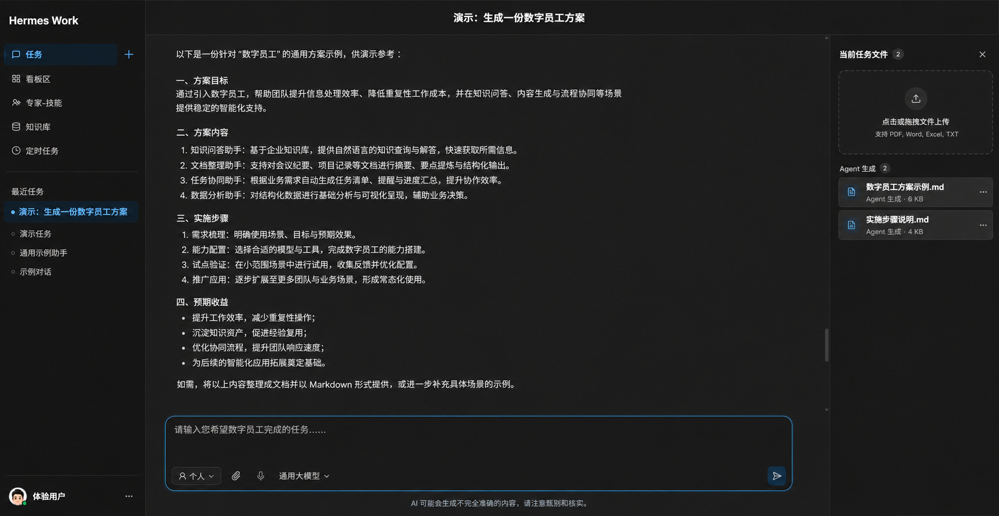
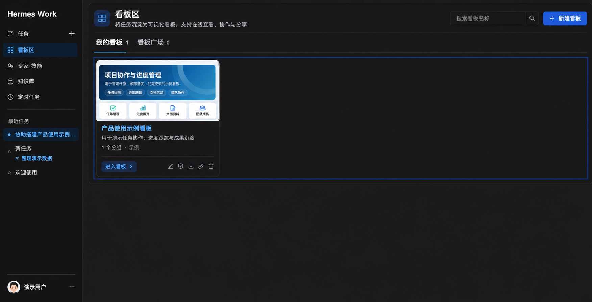
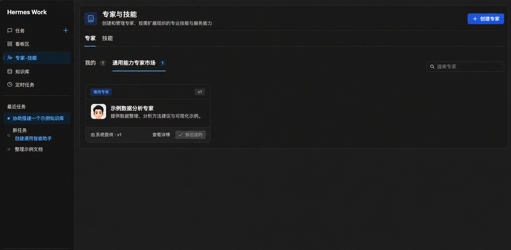
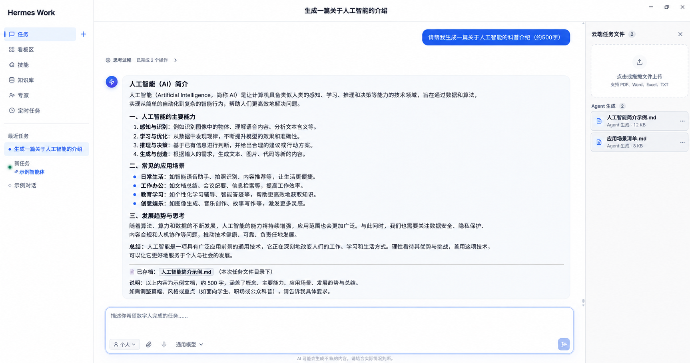
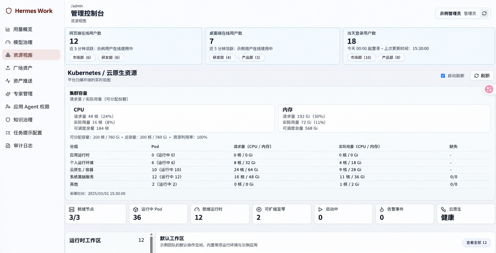
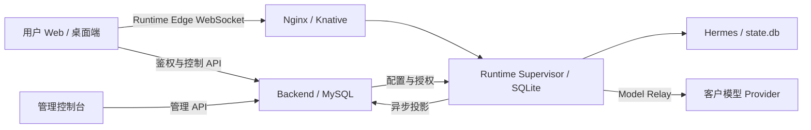

# Hermes Work 客户试用版

Hermes Work 是多用户 AI Agent 平台。本仓库提供用户 Web、管理控制台、桌面客户端、Backend 控制面、Runtime Supervisor 执行面，以及共享协议与运维脚本。此版本用于客户隔离环境试用；组织、身份源、模型供应商、存储和域名由部署方配置。

> 本仓库是独立源码快照，不包含原项目 Git 历史、内部知识内容、生产数据、密钥或已编译安装包。以下截图根据实际部署界面制作了脱敏示意，文字和统计数据均为示例。

## 产品界面

| 云端任务与文件 | 云端看板 |
| --- | --- |
|  |  |

| 专家与技能 | 桌面端 |
| --- | --- |
|  |  |

管理端资源视图：



## 核心能力

- 多用户登录与权限：支持标准 OAuth2，控制面管理组织、模型、专家、技能和应用 Agent。
- 实时任务：浏览器通过 Runtime Edge WebSocket 与独立 Runtime 通信，支持流式输出、恢复、取消和任务文件。
- 用户工作台：任务、看板、专家与技能、个人知识库、定时任务。
- 桌面客户端：共享主要用户界面，增加本地工作目录和文件能力。
- 管理控制台：模型治理、Runtime 资源、资产和权限管理。

企业知识的业务本体、语义模型、客户数据源映射及独立 Data Service 未随试用包提供。个人知识库和平台知识接口源码保留；企业知识能力须由客户按自身数据、权限与网络重新接入。

## 架构



Backend 负责身份、权限、配置和资源编排；Supervisor 负责 Session/Run、实时事件、幂等接纳和本地 journal；Hermes 负责会话正文、Agent 与工具执行。MySQL、Supervisor SQLite、Hermes `state.db` 分别保存各自权威数据。Backend 不转发实时 Token。

| 目录 | 用途 |
| --- | --- |
| `backend/` | FastAPI 控制面、MySQL 模型与接口 |
| `frontend/user-web/` | 用户 Web |
| `frontend/admin-web/` | 管理控制台 |
| `hermes-desktop/` | Electron 桌面端 |
| `runtime/supervisor/` | Runtime 执行面 |
| `runtime/` 其他目录 | Runtime 镜像 overlay、插件、基础技能 |
| `packages/` | 跨端 Schema 与 API client |
| `scripts/` | 构建、检查、验收和维护入口 |

## 部署与使用

1. 阅读[部署指南](docs/deployment.md)，准备 Linux、MySQL、Redis、Kubernetes/Knative、容器镜像仓库、Nginx、OAuth2 身份源和模型 Provider。
2. 从 `backend/env.example` 创建**不入 Git**的 `backend/.env`，填写客户自己的域名、凭据、组织 ID、Runtime 镜像和存储映射。
3. 按部署指南先建立 Runtime 基础设施，再初始化数据库、构建 Web、启动 Backend，最后完成首个用户 Runtime 验收。
4. 阅读[操作指南](docs/operations.md)：登录、模型发布、任务、看板、专家、个人知识和管理维护。

桌面端打包前必须显式设置客户平台 HTTPS origin 和 OAuth2 允许跳转域；不要直接使用源码中的 `example.com` 演示占位。所有部署脚本都有副作用，首次运行前先核对目标环境和参数。

## 验证

```bash
python3 -m compileall -q backend/app runtime/supervisor/platform_supervisor
export VITE_AUTH_MODE=oauth2
npm --prefix frontend/user-web ci
npm --prefix frontend/user-web run build
npm --prefix frontend/admin-web ci
npm --prefix frontend/admin-web run build
npm --prefix hermes-desktop ci
npm --prefix hermes-desktop run typecheck
```

这些命令验证源码和构建；真实登录、Run、镜像切换、PVC 单写与 TTFT 仍需在客户目标环境验收。

## 安全边界

- 不提交 `backend/.env`、OAuth2 client secret、模型 API Key、数据库密码、kubeconfig、证书、用户文件或运行日志。
- 不将原仓库历史、内部部署记录或组织知识资产合并到本仓库。
- 客户部署前按[部署指南](docs/deployment.md)替换所有 `example.com`、示例组织 ID、镜像和路径，并验证外部依赖的授权与许可证。
